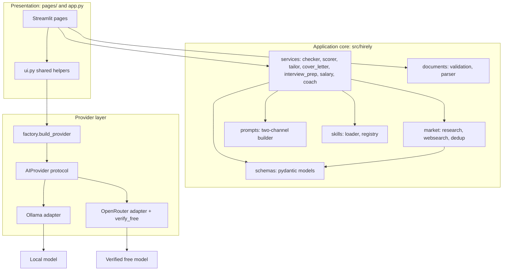
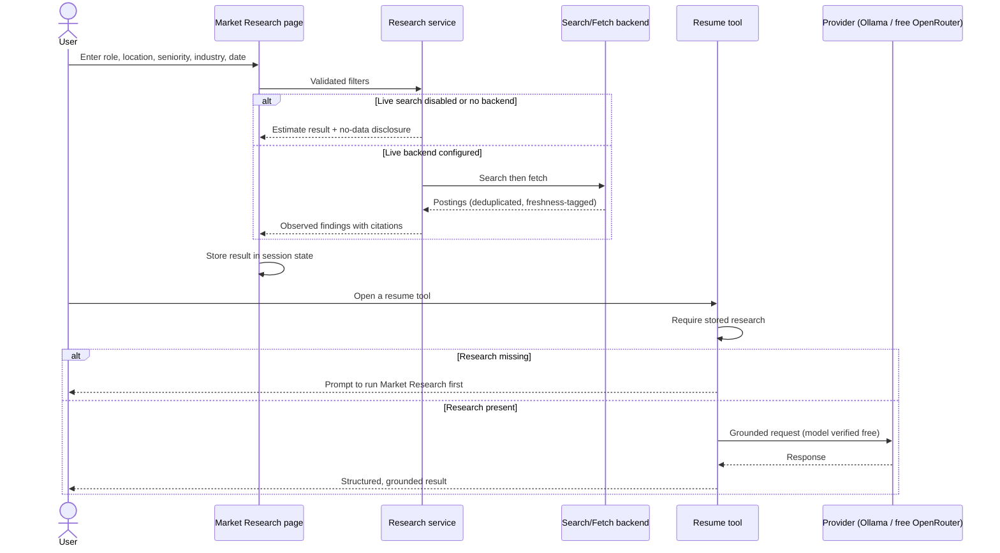

<div align="center">

# Hirely

### Zero-Cost AI Career Suite

Research the job market first, then build ATS-friendly resumes, cover letters, and interview and salary prep grounded strictly in your own experience, using local Ollama or free-verified OpenRouter models.


</div>

---

## Contents

- [Overview](#overview)
- [Features](#features)
- [Tech Stack](#tech-stack)
- [Architecture](#architecture)
- [Core Workflow](#core-workflow)
- [Prerequisites](#prerequisites)
- [Installation](#installation)
- [Environment Variables](#environment-variables)
- [Development Commands](#development-commands)
- [Docker](#docker)
- [Cost Notes](#cost-notes)
- [Project Structure](#project-structure)
- [Attribution](#attribution)

---

## Overview

Hirely is a Streamlit multipage application that runs AI inference at zero API cost. It defaults to local Ollama and uses OpenRouter only for models whose free status is verified from live pricing metadata before any request is sent. It never calls a paid model and never silently reroutes to one.

The product enforces a market-research-first workflow: downstream resume tools read the research captured in session state and prompt you to run Market Research before they generate or tailor anything. All AI output is grounded only in user-provided content, and the numeric resume score is computed by a deterministic rubric rather than the model.

Live external job search is disabled by default. Out of the box Hirely performs no outbound web request for market data; it shows a clear disclosure and treats any figures as model estimates, never as researched rates. A real live search backend is an operator responsibility implemented against the shipped adapter contract.

---

## Features

- **Market Research**: validated filters (role, location, industry, seniority, posting date), duplicate and stale-listing detection, and a no-network disclosure path. Observed findings always carry a source citation and retrieval date.
- **Resume Checker**: ATS-readiness review returning prioritized strengths, issues, and suggestions grounded in the uploaded resume.
- **Resume Scorer**: deterministic 0 to 100 match score from keyword coverage (`0.70 * required + 0.30 * preferred`), with interpretation bands and a separately labeled AI narrative that never changes the number.
- **Resume Tailor**: an explained change-set that tailors a resume to a specific posting.
- **Cover Letter**: generation with a deterministic validation contract. A missing resume, job description, title, or company returns a validation error and makes no provider call.
- **Interview Prep**: likely questions, guidance, and focus areas.
- **Salary Negotiation**: market-rate research that degrades to disclosed estimates when no live data is available, plus negotiation talking points.
- **Career Coach**: interactive Q&A using resume and job-description context.
- **Settings**: provider and model selection, non-billable connectivity checks, and free-model marking and filtering for OpenRouter.

Secure document handling validates extension, MIME type, size, and magic bytes, then parses PDF and DOCX text in memory. Encrypted, malformed, empty, and mislabeled files are rejected with user-safe messages. Uploaded documents and job descriptions are treated as untrusted data in a fenced user channel, never as instructions, so embedded instruction-like text is inert.

---

## Tech Stack

| Area | Choice | Version |
| --- | --- | --- |
| Language | Python | 3.11+ |
| UI | Streamlit | 1.66.1 |
| HTTP client | httpx | 0.28.1 |
| Validation | Pydantic | 2.14.1 |
| Settings | pydantic-settings | 2.16.1 |
| Env loading | python-dotenv | 1.2.4 |
| PDF parsing | PyMuPDF | 2.0 |
| DOCX parsing | python-docx | 1.2.0 |
| Tests | pytest + respx | 9.1.1 / 0.23.1 |
| Lint / types | ruff + mypy | 0.17.2 / 2.4.0 |
| Env / packaging | uv | 0.11+ |
| Container | Docker (multi-stage) | python:3.11-slim |

There is no LangChain, no vector database, no relational database, and no authentication service. All provider HTTP lives in the provider layer and all web HTTP lives in the market layer; pages hold only widget wiring and rendering.

---

## Architecture



---

## Core Workflow

Market Research runs before any resume generation. Downstream tools gate on the stored result.



---

## Prerequisites

- Python 3.11 or newer.
- [uv](https://docs.astral.sh/uv/) for environment and dependency management. Install it with `pipx install uv`, `pip install uv`, or the official standalone installer.
- For local inference: [Ollama](https://ollama.com) installed and running (`ollama serve`), with at least one model pulled (`ollama pull <model>`).
- For free cloud inference: an OpenRouter API key and a model that passes free verification.
- Optional: Docker, to build and run the container image.

---

## Installation

Dependencies are declared in `pyproject.toml` and locked in `uv.lock`. `uv sync` creates the virtual environment in `.venv` and installs the exact locked versions, including the `dev` group (pytest, respx, ruff, mypy).

```bash
uv sync
cp .env.example .env    # on Windows PowerShell: Copy-Item .env.example .env
```

For a runtime-only environment without the test and lint tools:

```bash
uv sync --no-dev
```

---

## Environment Variables

All variables are optional and have working defaults. They are read from the process environment and an optional `.env` file. Copy `.env.example` to `.env` and adjust as needed.

| Variable | Default | Description |
| --- | --- | --- |
| `AI_PROVIDER` | `ollama` | Active provider: `ollama` or `openrouter`. |
| `OLLAMA_BASE_URL` | `http://localhost:11434` | Base URL of the local Ollama server. |
| `OLLAMA_MODEL` | empty | Ollama model id; empty means choose at runtime from the installed list. |
| `OPENROUTER_API_KEY` | empty | OpenRouter key; required only when `AI_PROVIDER=openrouter`. |
| `OPENROUTER_MODEL` | empty | OpenRouter model id; must pass free verification before use. |
| `OPENROUTER_BASE_URL` | `https://openrouter.ai/api/v1` | OpenRouter API base URL. |
| `REQUEST_TIMEOUT_S` | `60` | Centralized provider HTTP timeout in seconds. |
| `MAX_RETRIES` | `2` | Bounded transient-only retry count. |
| `MAX_UPLOAD_MB` | `10` | Authoritative upload-size cap in megabytes. |
| `MARKET_SEARCH_ENABLED` | `false` | Gate for live market research. Disabled uses the disclosure path. |
| `MARKET_SEARCH_ENDPOINT` | empty | Optional keyless market-search endpoint. Blank or invalid falls back to the no-network path. |
| `MARKET_STALE_DAYS` | `45` | Listings older than this many days are flagged stale. |

Selecting `AI_PROVIDER=openrouter` without `OPENROUTER_API_KEY` fails at startup with a clear message. The default Ollama provider requires no OpenRouter configuration. Never commit a populated `.env`; it is git-ignored.

---

## Development Commands

Run from the repository root. `uv run` executes each command inside the project environment, so no manual activation is needed.

```bash
# Run the app
uv run streamlit run app.py

# Run the test suite (fully mocked, no network, no paid AI)
uv run pytest

# Lint and format check
uv run ruff check .
uv run ruff format --check .

# Type check
uv run mypy src
```

To add or remove a dependency, edit `pyproject.toml` (or use `uv add <pkg>` / `uv add --dev <pkg>`) and run `uv sync`; commit the updated `uv.lock`.

The test suite mocks all external HTTP with respx over httpx and runs document parsing against small committed fixtures in `tests/fixtures`. No test opens a real connection and no test issues a billable AI request.

---

## Docker

The image is a multi-stage build on `python:3.11-slim`. The builder stage uses uv to install the locked dependencies (`uv sync --frozen --no-dev`) into a virtual environment; the runtime stage copies only that environment plus `src/`, `app.py`, `pages/`, `.streamlit/`, and the vendored skills, and runs as a non-root user.

```bash
docker build -t hirely .
docker run --rm -p 8501:8501 --env-file .env hirely
```

The container exposes port 8501 and defines a healthcheck against Streamlit's `/_stcore/health` endpoint. To reach a local Ollama server from inside the container, point `OLLAMA_BASE_URL` at a host address your container networking can resolve.

---

## Cost Notes

AI inference is zero API cost: local Ollama runs on your hardware, and OpenRouter use is restricted to models verified free from live pricing metadata. Verification fails closed, so a model is rejected whenever its free status is missing, unparseable, or non-zero, and no inference request is sent in that case. No billable AI request is made during startup, discovery, health checks, or tests.

Zero AI API cost is not zero total cost. Local inference consumes CPU, memory, and disk. Container hosting and any operator-provided live market-search or data service may incur charges that are independent of Hirely. Those hosting and market-data costs are separate from the zero AI API cost guarantee.

---

## Project Structure

```text
hirely/
├── app.py                     # Entry point and dashboard
├── pages/                     # Streamlit pages (Market Research is page 1)
├── src/hirely/
│   ├── config.py              # Pydantic settings and zero-cost validation
│   ├── logging_setup.py       # PII-safe logging
│   ├── ui.py                  # Shared UI helpers and session contract
│   ├── providers/             # base, factory, ollama, openrouter, retry
│   ├── market/                # research, websearch (NullBackend), dedup
│   ├── documents/             # validation, parser
│   ├── prompts/               # two-channel prompt builder
│   ├── skills/                # loader, registry
│   ├── services/              # one module per feature
│   └── schemas/               # pydantic models
├── tests/                     # pytest suite + fixtures
├── .streamlit/config.toml     # theme, headless, upload ceiling
├── pyproject.toml             # project metadata, dependencies, tool config
├── uv.lock                    # locked dependency versions
├── Dockerfile                 # multi-stage, non-root runtime
├── .env.example               # configuration template, empty secrets
├── THIRD_PARTY_LICENSES.md    # vendored-skill attribution
└── .agents/skills/            # vendored ResumeSkills frameworks
```

---

## Attribution

Hirely vendors eight agent skills from the [ResumeSkills](https://github.com/Paramchoudhary/ResumeSkills) project under the MIT License. The vendored `SKILL.md` files are preserved byte-for-byte. See [THIRD_PARTY_LICENSES.md](THIRD_PARTY_LICENSES.md) for full license text and attribution.
